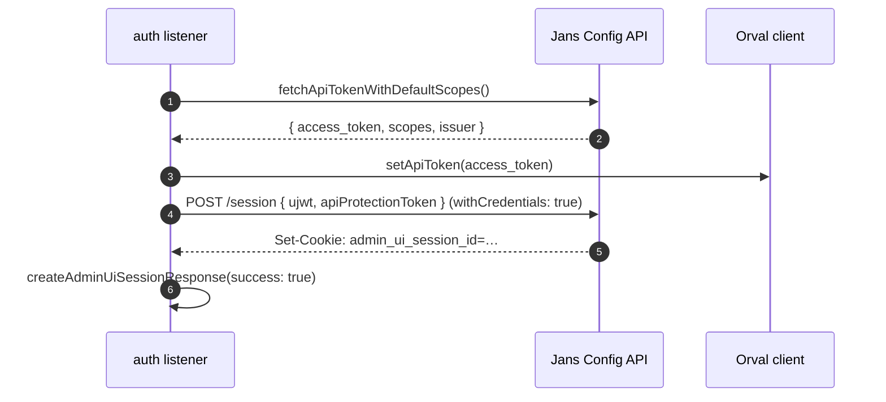
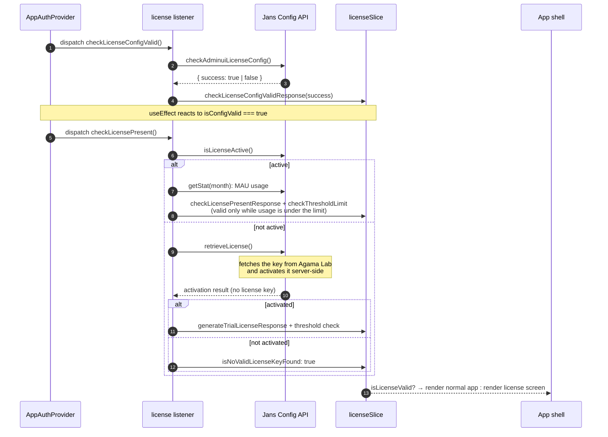

# Authentication

## Introduction

Authentication answers one question: **who is the user sitting in front of the browser?** The Admin UI gets the answer by signing the user in to the **Jans Auth Server** using **OAuth 2.0 / OpenID Connect with PKCE**. The flow is driven by [`@openid/appauth`](https://www.npmjs.com/package/@openid/appauth) (AppAuth-JS): the UI never sees a client secret.

Out of scope here:

- **What the user is allowed to do**: decided by Cedarling at the page boundary, see [cedarling.md](./cedarling.md).
- **The Config API call itself**: how the session cookie reaches outgoing requests is covered in [config-api.md](./config-api.md). This doc covers how the session is _established_.

## Where the code lives

- **OIDC sign-in**: [`app/utils/AppAuthProvider.tsx`](../app/utils/AppAuthProvider.tsx), [`app/utils/TokenController.ts`](../app/utils/TokenController.ts), [`app/utils/urlSecurity.ts`](../app/utils/urlSecurity.ts)
- **Auth state**: [`app/redux/features/authSlice.ts`](../app/redux/features/authSlice.ts), [`app/redux/listeners/authListener.ts`](../app/redux/listeners/authListener.ts)
- **License flow**: [`app/redux/features/licenseSlice.ts`](../app/redux/features/licenseSlice.ts), [`app/redux/listeners/licenseListener.ts`](../app/redux/listeners/licenseListener.ts)
- **Idle timeout**: [`app/routes/Apps/Gluu/GluuSessionTimeout.tsx`](../app/routes/Apps/Gluu/GluuSessionTimeout.tsx), [`app/hooks/useIdleTimer/useIdleTimer.ts`](../app/hooks/useIdleTimer/useIdleTimer.ts)
- **Logout**: [`app/routes/Pages/ByeBye.tsx`](../app/routes/Pages/ByeBye.tsx), [`app/redux/listeners/authListener.ts`](../app/redux/listeners/authListener.ts), [`app/redux/listeners/sessionListener.ts`](../app/redux/listeners/sessionListener.ts)
- **Startup and tabs**: [`app/utils/startAtRoot.ts`](../app/utils/startAtRoot.ts), [`app/utils/legacyAuthStorage.ts`](../app/utils/legacyAuthStorage.ts), [`app/utils/authSync.ts`](../app/utils/authSync.ts), [`app/utils/forceLogin.ts`](../app/utils/forceLogin.ts)
- **Storage keys**: [`app/constants/storageKeys.ts`](../app/constants/storageKeys.ts), see [Storage keys](#storage-keys)

## OAuth / PKCE sign-in

### Flow diagram

```mermaid
sequenceDiagram
    autonumber
    participant Browser as Browser (Admin UI)
    participant Provider as AppAuthProvider
    participant Jans as Jans Auth Server
    participant Redux as authReducer

    Browser->>Provider: visit /admin/ (no session)
    Provider->>Redux: dispatch checkLicenseConfigValid() then checkLicensePresent()
    Provider->>Provider: build AuthorizationRequest<br/>(code_challenge from PKCE verifier; only once license is valid)
    Provider->>Jans: redirect → /authorize?code_challenge=…
    Jans-->>Browser: user authenticates on Jans
    Jans->>Provider: redirect back with ?code=…
    Provider->>Jans: POST /token (code + code_verifier)
    Jans-->>Provider: id_token, access_token
    Provider->>Jans: GET /userinfo (access_token)
    Jans-->>Provider: userinfo JWT
    Provider->>Provider: decode userinfo JWT → userinfo
    Provider->>Redux: dispatch getUserInfoResponse (userinfo + tokens)
```

### Explanation of the flow

The browser opens the Admin UI at `/admin/`. [`app/utils/AppAuthProvider.tsx`](../app/utils/AppAuthProvider.tsx) mounts and checks whether a valid session already exists in [`authReducer`](../app/redux/features/authSlice.ts). If not, it begins an **OAuth Authorization Code flow with PKCE**.

**PKCE** replaces the client secret. The browser generates a random secret called a **code verifier**, hashes it into a **code challenge**, and sends only the challenge with the redirect to the auth server. The auth server stores the challenge against this login attempt. When the browser later exchanges its authorization code for tokens, it sends the original verifier. The server hashes it and compares to the stored challenge. This proves the same browser that started the login is finishing it, without the Admin UI ever needing to hold a client secret.

The browser is redirected to the Jans Auth Server's `/authorize` endpoint. The user signs in there. Jans redirects back to the registered redirect URI with `?code=…&state=…`. A standard install registers `https://<host>/admin`, so the callback lands on the app's base path, which [`startAtRoot`](../app/utils/startAtRoot.ts) leaves as it is.

`AppAuthProvider` sees the `code` in the URL and exchanges it for tokens by POSTing to the auth server's `/token` endpoint with `grant_type=authorization_code`, the code, and the original code verifier. No client secret is involved.

The response carries an `id_token` (proof of identity, signed JWT) and an `access_token` (for the UI's own scopes). `AppAuthProvider` then calls the auth server's `/userinfo` endpoint with the access token, which returns the user profile as a signed JWT. It decodes that JWT with `jwt-decode` (`userinfo`: email, name, `jansAdminUIRole`, etc.) and dispatches `getUserInfoResponse` with the tokens and decoded userinfo into [`authSlice`](../app/redux/features/authSlice.ts).

Once the userinfo and tokens are in Redux and the user has a valid `jansAdminUIRole`, the provider dispatches `getAPIAccessToken(userinfo_jwt)` to create the server-side Admin UI session. The license was already verified on mount: `checkLicenseConfigValid()` then `checkLicensePresent()` run first and gate the `/authorize` redirect, so by this point the license is valid. The user is signed in to the auth server, but the Admin UI is not usable until that session exists.

## Admin-UI session

### Why it exists

OIDC sign-in alone does **not** let the UI talk to the Config API. The Config API authenticates every regular request through a **session cookie** that proves the caller went through the Admin UI sign-in flow (rather than a script bypassing it). `createAdminUiSession` is what mints that cookie on the server side.

### Flow diagram



### Explanation of the flow

The flow is driven by [`app/redux/listeners/authListener.ts`](../app/redux/listeners/authListener.ts). After the OAuth/PKCE step writes the user info into Redux, `AppAuthProvider` dispatches `getAPIAccessToken`. The listener calls `fetchApiTokenWithDefaultScopes()` and receives back an `access_token` along with side values (`issuer` and the requested scopes). Separately, the `getOAuth2Config` listener calls `fetchServerConfiguration()` and dispatches the result (including `postLogoutRedirectUri`) into `authReducer.config`.

The listener hands the token to the Orval client by calling `setApiToken(access_token)` so the upcoming `POST /session` call carries the right header. Once the session cookie is set, regular Config API traffic authenticates off the cookie (see [config-api.md](./config-api.md)). The OAuth2 server config (including `postLogoutRedirectUri`) is dispatched into Redux `authReducer.config` and kept there, so [`ByeBye.tsx`](../app/routes/Pages/ByeBye.tsx) reads it as the logout fallback.

Then comes the session creation. The listener dispatches `createAdminUiSession({ ujwt, apiProtectionToken })`:

- **`ujwt`** is the user JWT. Proof of identity.
- **`apiProtectionToken`** is a separate short-lived token that protects the session-creation endpoint itself.

The helper in [`app/redux/api/backend-api.ts`](../app/redux/api/backend-api.ts) POSTs to `ENDPOINTS.SESSION` with `withCredentials: true`, which tells the browser to accept any `Set-Cookie` header in the response and to send it back on subsequent requests to the same origin.

The Config API creates a server-side session record, sets a cookie, and returns success. The listener dispatches `createAdminUiSessionResponse({ success: true })`, and the reducer flips `state.authReducer.hasSession` to `true`: unblocking the rest of the app.

If `createAdminUiSession` returns 403, that means the user signed in successfully but does not have the `jansAdminUIRole` claim. The listener in [`app/redux/listeners/authListener.ts`](../app/redux/listeners/authListener.ts) then calls `auditSessionExpired()`, which dispatches `auditLogoutLogs` and forces sign-out (see [Trigger paths](#trigger-paths)).

After this, every Config API call goes through the shared axios instance in [`orval/axiosInstance.ts`](../orval/axiosInstance.ts). The browser sends the `admin_ui_session_id` cookie alongside each request, and the Config API authenticates the caller off that cookie.

## License verification

### Why it exists

The Admin UI is part of **Gluu Flex**. A working installation must have an active license. Without one, the app shows a **license-error screen** instead of the normal sidebar, with options to upload a Software Statement Assertion (SSA) or start a 30-day trial. License verification runs when the app loads, before the redirect to the sign-in page, and decides which screen the user sees: the normal app, or the license-error screen.

The check has two halves, run sequentially:

1. **Config check** ([`checkLicenseConfigValid`](../app/redux/listeners/licenseListener.ts)): is the license-related OIDC configuration in persistence valid? In other words: is the Admin UI even able to _ask_ the License APIs anything?
2. **Presence check** ([`checkLicensePresent`](../app/redux/listeners/licenseListener.ts)): given the config is valid, does this installation have an active license, and is the user under the licensed MAU (Monthly Active User) cap?

If either half fails, the user lands on the license-error screen. If both pass, the rest of the app renders.

### Flow diagram



### Explanation of the flow

The flow is driven by [`app/redux/listeners/licenseListener.ts`](../app/redux/listeners/licenseListener.ts), and the state it manipulates lives in [`app/redux/features/licenseSlice.ts`](../app/redux/features/licenseSlice.ts). It is kicked off by [`app/utils/AppAuthProvider.tsx`](../app/utils/AppAuthProvider.tsx): two `useEffect`s, run sequentially, not in parallel.

**Step 1: Config check.** `AppAuthProvider` dispatches `checkLicenseConfigValid()` once, guarded by a `hasDispatchedConfigCheck` ref. The listener's `checkAdminuiLicenseConfigWorker` calls the `checkAdminuiLicenseConfig` Orval hook, which asks the Config API whether the OIDC client used to talk to the License APIs is valid. The response is a `{ success: boolean }`. The listener dispatches `checkLicenseConfigValidResponse(success)`, which sets `state.licenseReducer.isConfigValid`.

If `isConfigValid` is `false`, the UI shows the SSA-upload screen and the flow stops. The user uploads a fresh SSA, which routes back through `uploadNewSsaToken` in the same listener. On success it re-runs the config check. If `isConfigValid` is `true`, a second `useEffect` in `AppAuthProvider` reacts and dispatches `checkLicensePresent()`.

**Step 2: Presence check.** `checkLicensePresentWorker` calls the `isLicenseActive` Orval hook. The Config API resolves this against its license backend (at most once per 30 days, otherwise it returns the cached result from persistence). If `success: true`, the response carries license fields (expiry, MAU cap, etc.). The listener reads the MAU cap from the `mau_threshold` entry and moves on to Step 3. The license is not marked valid yet; that happens only after the MAU check passes. If that entry is missing or is not a number, the listener treats the installation as having no valid license and dispatches `isNoValidLicenseKeyFound: true`.

**Step 3: MAU threshold.** With an active license, the listener calls the `getStat` Orval hook for the current month and compares the usage against a limit of the licensed MAU cap plus 15%. If usage is under that limit, or there is no usage data yet, the listener dispatches `checkLicensePresentResponse({ isLicenseValid: true })` and `checkThresholdLimit({ isUnderThresholdLimit: true })`, and sign-in continues. If usage is over the limit, it dispatches `checkThresholdLimit({ isUnderThresholdLimit: false })` and the license is not marked valid. `AppAuthProvider` then shows a full-screen `GluuErrorModal` telling the user to upgrade the plan in Agama Lab, and sign-in does not continue. If the `getStat` call itself fails, the listener sets the error and `isNoValidLicenseKeyFound: true`, so the user sees the license-error screen.

**Step 4: Not active → retrieve and activate.** If `isLicenseActive` returned `{ success: false }`, the listener falls into `retrieveAndActivateLicense`. This calls `retrieveLicense` (Orval). In that one call, the Config API fetches the license key from Agama Lab and activates it on the server. The license key never reaches the browser, and the browser never sends it back. If the call succeeds (the user has subscribed in Agama Lab), the listener reads `mau_threshold` from the response. If the response does not include it, the listener calls `isLicenseActive` again to read it. The listener then dispatches `generateTrialLicenseResponse(...)` and runs the MAU threshold check. If the call fails (for example, the user has not subscribed), or no valid `mau_threshold` is found, the listener dispatches `isNoValidLicenseKeyFound: true` and the UI offers a 30-day trial. The trial can only be generated once per Agama Lab user. `generateTrialLicense` runs `startTrialLicense`, which calls `getTrialLicense` (Orval). The Config API generates the trial license and activates it on the server in the same way, so the trial key also stays on the server. The listener dispatches `generateTrialLicenseResponse(...)` with the result and sets `isLicenseValid` from its `success` flag.

**Error / network handling.** Errors are handled differently at each step of [`licenseListener.ts`](../app/redux/listeners/licenseListener.ts):

- **Retrieve, trial and MAU check:** the failure is turned into a message with `getLicenseErrorMessage` and dispatched with `setLicenseError`. The license-error screen ([`ApiKey.tsx`](../app/components/LicenseScreens/ApiKey.tsx)) shows it.
- **SSA upload:** the message goes into `errorSSA` through `uploadNewSsaTokenResponse`, and the SSA-upload screen shows it.
- **Presence check:** if `isLicenseActive` throws, the error is only logged, and the listener falls back to retrieve and activate (Step 4).
- **Config check:** any error other than an auth failure sets `isConfigValid` to `false`, which shows the SSA-upload screen.

The license-config check also handles auth failures: `isAuthFailure` treats both 401 and 403 (`AUTH_FAILURE_STATUSES`) as a hard sign-out and dispatches `handleSessionExpired`. A 401 means the request was not authenticated, or the credentials were rejected; a 403 means the caller is authenticated but lacks the role to call the license endpoints. Either way the call cannot succeed by retrying, so the app signs out. Backend reachability is tracked separately: when the API-protection-token call fails, [`authListener.ts`](../app/redux/listeners/authListener.ts) dispatches `setBackendStatus` with the status code and message, and `ApiKeyRedirect` renders the global `GluuErrorModal` with the service-down image.

### Slice fields the UI reads

The `licenseSlice` exposes several booleans that the app shell uses to decide which screen to render:

- `isLicenseValid`: the master gate for normal app rendering.
- `islicenseCheckResultLoaded`: distinguishes "still loading the check" from "loaded and invalid".
- `isNoValidLicenseKeyFound`, `error`, `errorSSA`: drive the license-error screen sub-states (trial offer, SSA upload prompt, plain error).
- `isConfigValid`: the result of the config-check half. Tracked separately from `isLicenseValid` because the config check can fail on its own and produces the SSA-upload screen.
- `isUnderThresholdLimit`: when `false`, shows the full-screen "MAU over the limit" error modal.
- `isValidatingFlow`, `generatingTrialKey`, `isLoading`: UI spinner state on the license screens.

## Tokens

Four tokens are held in memory, and they are **not interchangeable**:

| Token                      | Kept in                                                   | Returned by                                                                 | Used for                                                                                     |
| -------------------------- | --------------------------------------------------------- | --------------------------------------------------------------------------- | -------------------------------------------------------------------------------------------- |
| API protection token       | `orval/axiosInstance.ts` (`setApiToken` / `getApiToken`)  | Config API `POST /jans-config-api/app/admin-ui/oauth2/api-protection-token` | The bootstrap calls (license checks, OAuth config) and `POST /session`                       |
| `id_token`                 | `state.authReducer.idToken`                               | Auth Server `POST /jans-auth/restv1/token` (code + PKCE verifier)           | `id_token_hint` on the end-session call at sign-out                                          |
| `access_token` (UI scopes) | `state.authReducer.jwtToken`                              | The same `/token` call                                                      | Calling `/userinfo`                                                                          |
| `userinfo_jwt`             | `state.authReducer.userinfo_jwt`, decoded into `userinfo` | Auth Server `GET /jans-auth/restv1/userinfo` (`access_token` as Bearer)     | The user's profile and `jansAdminUIRole`, and the `ujwt` sent to create the Admin UI session |

The Admin UI session itself is the `admin_ui_session_id` cookie, set by Config API `POST /jans-config-api/app/admin-ui/oauth2/session` from `userinfo_jwt` and the API protection token. It is HttpOnly, so the app never reads it; the browser sends it with every later Config API call.

Every page load runs the same order: API protection token, license checks, `/authorize`, `/token`, `/userinfo`, then `/session`. On a reload the `/authorize` step needs no password while the Auth Server session is valid.

Tokens live in memory only and are never written to `localStorage` or `sessionStorage`. AppAuth keeps the sign-in in progress (state and PKCE verifier) in `sessionStorage`, so it belongs to one tab and is removed when that sign-in completes. The few small values the app does store (issuer, sign-out time, one-tab flags) are listed under [Storage keys](#storage-keys).

### Reloads and new tabs

A reload or a new tab starts with empty memory, so the app runs the normal sign-in. While the Auth Server session is still valid, Jans returns a code without asking for credentials, so the user only sees a short redirect. [`startAtRoot`](../app/utils/startAtRoot.ts) always starts the app at `/admin/`, except a load on `/admin/logout`, which it leaves alone so the sign-out can finish.

If a tab returns from the Auth Server with a code it can't use, it restarts sign-in once, then shows an error. This happens when two tabs sit on the login page at the same time, for example after a sign-out sends every open tab there. Jans keeps one pending sign-in per browser session, so the tab that submits the form can come back with the other tab's sign-in request. The restart signs that tab in silently. The other tab's login page no longer works on the Auth Server side: reloading or submitting it shows "This flow may have already finished/timed out". Opening `/admin/` again in that tab signs it in silently.

## Storage keys

`localStorage` holds two kinds of values. Preferences have to be readable **before** React and Redux boot: theme and language are needed for the first paint, otherwise the user sees a flash of the wrong theme. A few small values are shared between tabs: the last sign-out time and the last activity time. No token is stored.

Every key lives in [`app/constants/storageKeys.ts`](../app/constants/storageKeys.ts), except two older `sessionStorage` flags that are defined in their own helpers: `forceLogin` in [`forceLogin.ts`](../app/utils/forceLogin.ts) and `noRoleSignOut` in [`noRoleSignOut.ts`](../app/utils/noRoleSignOut.ts). Don't add inline string keys.

Application code reads and writes through the `storage` helper in [`app/utils/storage.ts`](../app/utils/storage.ts) (`get` / `set` / `getJSON` / `setJSON` / `remove` / `clear` / `keys`), which guards SSR and swallows quota and parse errors. `sessionStore` is the same helper for `sessionStorage`. Raw `localStorage` access is limited to two places: the pre-paint theme script in `index.html`, which has to run before the bundle loads, and [`logLevel.ts`](../app/utils/logLevel.ts), which the logger reads. The `storage` helper logs through the logger, so using it in `logLevel.ts` would be a circular import.

| Key                 | Feature                                                               | Set by                                                                  | Read by                                                                                          |
| ------------------- | --------------------------------------------------------------------- | ----------------------------------------------------------------------- | ------------------------------------------------------------------------------------------------ |
| `USER_CONFIG`       | Per-user theme and language preferences                               | `useThemePersistence`, `useLangPersistence`                             | `userConfig.ts`, `i18n.ts`, `themeContext`                                                       |
| `INIT_THEME`        | UI theme (light/dark)                                                 | `themeContext`, `useThemePersistence`, `clearAppStorage` reset          | `themeContext`, `default.tsx` layout, `index.html` pre-paint script                              |
| `INIT_LANG`         | UI language                                                           | `useLangPersistence`, `clearAppStorage` reset                           | `i18n.ts`, `useLangPersistence`                                                                  |
| `ISSUER`            | OIDC issuer URL                                                       | `TokenController.saveIssuer` when sign-in starts                        | `TokenController.getIssuer`: the callback load, and the fallback for the `issuer` request header |
| `PAGING_SIZE`       | Rows per page in tables                                               | `pagingUtils`                                                           | `pagingUtils`                                                                                    |
| `LOG_LEVEL`         | Browser log level (default `INFO`)                                    | `logLevel.ts`, from the Settings page                                   | `logger`, through `logLevel.ts`                                                                  |
| `SIGNED_OUT_AT`     | Time of the last sign-out, so the other open tabs follow it           | `sessionListener` on `logoutUser`; kept by `clearAppStorage`            | `authSync`, in the other tabs and in the 401 recovery                                            |
| `LAST_ACTIVITY`     | Last user activity in any tab, for the shared idle timer              | `useIdleTimer` (at most every 10 s)                                     | `useIdleTimer` in every tab                                                                      |
| `SIGN_IN_RESTARTED` | `sessionStorage`: sign-in was restarted once in this tab              | `authSync.restartSignInOnce`                                            | `authSync`; removed on sign-in                                                                   |
| `forceLogin`        | `sessionStorage`: the next sign-in must show the login form           | `ByeBye` fallbacks, a sign-out in another tab, the sign-in retry button | `AppAuthProvider`, which adds `prompt=login` and removes the flag                                |
| `noRoleSignOut`     | `sessionStorage`: the user was signed out for having no Admin UI role | `AppAuthProvider`                                                       | `AppAuthProvider`, which shows the role error instead of signing in again                        |

On startup, [`clearLegacyAuthStorage`](../app/utils/legacyAuthStorage.ts) removes what older builds left in `localStorage`: the `persist:root` Redux state (which held the tokens) and AppAuth sign-in requests.

## 401 vs 403

The Config API rejects with two distinct status codes, and the shared axios response interceptor in [`orval/interceptors.ts`](../orval/interceptors.ts) handles each globally:

- **401 (unauthorized)**: no session cookie and no valid token. The interceptor calls `recoverAdminUiSession()` once to re-mint the Admin UI session, then retries the original request. The same applies to the backend client in [`app/redux/api/axios.ts`](../app/redux/api/axios.ts), except for the session and API protection token endpoints. If the user signed out in another tab since this tab signed in, the tab goes to the login page instead of recovering. If recovery fails, the error propagates.
- **403 (forbidden)**: the session cookie names a session the server no longer has. It expired (no API call for `sessionTimeoutInMins`) or was revoked, for example after a password change. The Orval interceptor opens the session-expired modal, and signing out from it runs the logout flow below. A 403 is never recovered automatically, so the UI can't undo a revocation.

`isFourZeroThreeError(err)` in [`app/utils/TokenController.ts`](../app/utils/TokenController.ts) detects a 403. Both paths are global, so pages don't handle 401 or 403 themselves. A few listeners still react to an auth failure directly, for example the license config check above and the auth listener's config fetch and save.

## Idle timeout

Users who leave the Admin UI open without interaction are signed out automatically. This protects browser tabs left unattended on shared machines.

[`app/routes/Apps/Gluu/GluuSessionTimeout.tsx`](../app/routes/Apps/Gluu/GluuSessionTimeout.tsx) wraps the app and tracks activity with the app's own [`useIdleTimer`](../app/hooks/useIdleTimer/useIdleTimer.ts) hook. The defaults are 30 minutes idle, then a ten-second countdown modal warning the user, then a forced logout. The idle window is configurable per environment via `sessionTimeoutInMins` on the auth slice. When the modal countdown expires, the component dispatches `auditLogoutLogs`, which records the involuntary logout in the audit trail and sets `logoutRequested`. [`AuthenticatedRouteSelector`](../app/components/App/AuthenticatedRouteSelector.tsx) then navigates to `/logout`, and the logout flow below takes over.

Idle time is shared between tabs. Each tab records its last activity in `LAST_ACTIVITY` (at most every 10 seconds) and restarts its own timer when another tab records one. The user is signed out only when every open tab has been idle, and activity in another tab also closes an open countdown modal.

## Logout

Logout is one cleanup path. Every trigger routes the browser to `/logout`, which is served by [`app/routes/Pages/ByeBye.tsx`](../app/routes/Pages/ByeBye.tsx).

### Trigger paths

- **User-initiated**: the sidebar logout link routes to `/logout` → `ByeBye.tsx`.
- **Forced**: when a listener in [`app/redux/listeners/authListener.ts`](../app/redux/listeners/authListener.ts) hits a fatal auth error (e.g. 403 from `createAdminUiSession`), it calls `auditSessionExpired()`, which dispatches `auditLogoutLogs`. That sets `logoutRequested` in the session slice, and [`AuthenticatedRouteSelector`](../app/components/App/AuthenticatedRouteSelector.tsx) navigates to `/logout`.
- **Idle timeout**: `GluuSessionTimeout` dispatches `auditLogoutLogs`, which audits the involuntary exit and leads to the same navigation to `/logout`.
- **Other pages**: the License page (after a license reset, or when the license has expired), activating a different policy store, and a role that can open no page at all also navigate to `/logout`.

A sign-out in one tab reaches the others without routing them to `/logout`. The other signed-in tabs see `SIGNED_OUT_AT` change (or find it newer than their own sign-in when they become visible again). They set the force-login flag and reload to the start, which shows the login page. They don't repeat the end-session call: Jans answers a second end-session request for an ended session with a 400 error.

### What `ByeBye.tsx` does, in order

1. `dispatch(setAuthState({ state: false }))`: flips the auth flag immediately so any guarded UI hides while the rest of the cleanup runs.
2. If `state.authReducer.hasSession` is `true`, calls `deleteAdminUiSession()` against `ENDPOINTS.SESSION` (DELETE) so the Config API invalidates the admin-UI session cookie. Failures are logged but do not block the rest of logout.
3. `dispatch(logoutUser())`: the `logoutSlice` reducer runs [`clearAppStorage`](../app/utils/clearAppStorage.ts), which clears `localStorage` except the preferences (`USER_CONFIG`, `INIT_THEME`, `INIT_LANG`, paging size, log level) and `SIGNED_OUT_AT`. Keeping `SIGNED_OUT_AT` means no clear, here or on a sign-in retry, can hide a sign-out from a tab that hasn't seen it yet. The session listener then records the new sign-out time so the other tabs follow.
4. If the OAuth config has an `endSessionEndpoint`, builds the end-session URL with `buildSafeLogoutUrl(endSessionEndpoint, postLogoutRedirectUri, state, idToken)` (from [`app/utils/urlSecurity.ts`](../app/utils/urlSecurity.ts)), which sends the `id_token` as `id_token_hint`, and redirects there. Jans clears its own session and returns the browser to the redirect URI.
5. **Fallback**: if no `endSessionEndpoint` is available, redirects to `config.postLogoutRedirectUri` from `authReducer.config` (validated via `buildSafeNavigationUrl`), or the app's base path (`/admin/`) as a last resort. Every fallback, including an end-session URL that fails the safety check, sets the force-login flag first: without the end-session call the Auth Server session is still alive, so the next sign-in must ask for the password. This also covers a reload on `/logout`, where the config is no longer in memory.

`buildSafeLogoutUrl` and `buildSafeNavigationUrl` exist because constructing these URLs by hand is error-prone. A crafted `post_logout_redirect_uri` is a URL-injection vector. Always go through them.

## OAuth scopes vs Cedarling resource scopes

Two unrelated things are both called "scopes":

- **OIDC scopes** are declared in the auth config the Jans server hands back. AppAuth lists them in the `AuthorizationRequest`. They control what the OIDC token can be used for.
- **Cedarling resource scopes** are derived from [`RESOURCE_ACTIONS`](../app/cedarling/constants/resourceCatalog.ts) and evaluated at the page boundary by `usePermission()`. They control which UI elements render for which role.

A user can be signed in (OIDC scopes valid) but unauthorized (Cedarling denies). That is the normal case for role-restricted pages. See [cedarling.md](./cedarling.md).

## Debugging tips

- AppAuth has a verbose log flag. At the top of [`app/utils/AppAuthProvider.tsx`](../app/utils/AppAuthProvider.tsx), calling `setFlag('IS_LOG', true)` traces the OAuth flow locally. Useful for tracking down redirect mismatches. Never ship with this flag enabled.
- `redux-devtools` shows the full `authReducer` slice. If Config API calls fail with `401`, check `state.authReducer.hasSession`: a `false` value means `createAdminUiSession` never succeeded, so no session cookie exists and the Config API rejects every request.
- If the user is bounced back to the login screen immediately after sign-in, the cause is almost always the `createAdminUiSession` 403 path. The user signed in but does not have the `jansAdminUIRole` claim. Check the Jans Auth Server's user record.
