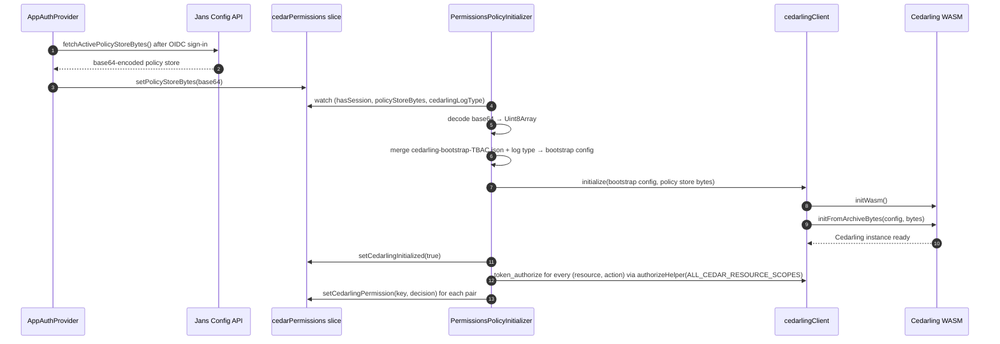
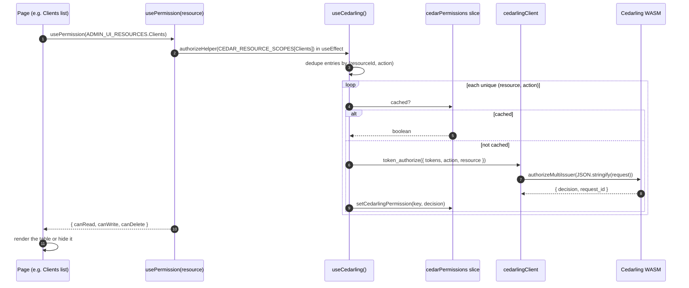

# Access Control using Cedarling

## Introduction

The Admin UI never hard-codes who-can-do-what. Instead, every permission check goes through **Cedarling**: a [Cedar](https://www.cedarpolicy.com/) policy engine, provided by the Janssen Project, compiled to WebAssembly (WASM) and bundled into the app.

Three things make this design unusual:

- **Cedarling runs inside the browser.** The engine, the policies, and the user's tokens are all in memory in the same tab. There is no network round-trip to evaluate a permission.
- **Policies are data, not code.** The rules ("a user with role X can read resource Y") live in a JSON file called a **policy store**, loaded into Cedarling at startup. Changing who can do what is a policy-store edit, not a component change.
- **The UI gate is the first gate, not the only one.** Even when Cedarling says "yes", the Jans Config API revalidates server-side and can still return 403. Cedarling hides UI elements the user can't use. It does not replace server-side authorization.

The check itself is simple: every page that gates a button, an action, or a whole section calls `usePermission(resource)` and gets back `{ canRead, canWrite, canDelete }`. Every `(resource, action)` pair is evaluated once, right after Cedarling starts, while the sign-in tokens are still valid. Every later answer is a Redux cache read.

## Flow diagram

There are two distinct phases. Phase 1 happens once per session, right after sign-in. Phase 2 happens every time a guarded page mounts.

### Phase 1: Bootstrap



### Phase 2: Per-page permission check



## Explanation of the flow

### Phase 1: Bootstrap

When the user finishes signing in, [`app/utils/AppAuthProvider.tsx`](../app/utils/AppAuthProvider.tsx) does two things: it stores the tokens, and it calls `fetchActivePolicyStoreBytes()` against the Jans Config API. The response is a base64-encoded blob containing the Cedar policies that describe who can do what. `AppAuthProvider` writes that blob into the [`cedarPermissions` slice](../app/redux/features/cedarPermissionsSlice.ts) (`setPolicyStoreBytes`).

[`app/components/App/PermissionsPolicyInitializer.tsx`](../app/components/App/PermissionsPolicyInitializer.tsx) is a render-less component mounted inside the signed-in layout by [`AuthenticatedRouteSelector`](../app/components/App/AuthenticatedRouteSelector.tsx), so it lives for the whole signed-in session and unmounts on `/logout`. It watches the Redux store and waits until three things are present at the same time:

- a session exists (`hasSession`)
- the policy store bytes have arrived (`policyStoreBytes` is non-empty)
- a log type is configured (`cedarlingLogType`)

Once all three are ready, it:

1. **Decodes** the base64 string into a `Uint8Array`.
2. **Merges the bootstrap config**: a static JSON file at [`app/cedarling/config/cedarling-bootstrap-TBAC.json`](../app/cedarling/config/cedarling-bootstrap-TBAC.json) gets combined with the runtime-configured log type to produce the full bootstrap configuration that Cedarling will initialize with. The log type comes from the Config API (`authReducer.config.cedarlingLogType`) and is one of the values in [`CEDARLING_LOG_TYPE`](../app/cedarling/constants/cedarlingConstants.ts): `OFF` (default) or `STD_OUT`. This step tells Cedarling _how_ to behave (logging, schema, token issuers). The policy store tells it _what to enforce_. The same value also gates the Admin UI's own Cedarling console output through `cedarLogger` - see [Logging](#logging).
3. **Initializes Cedarling** by calling `cedarlingClient.initialize(bootstrap config, policy store bytes)`. [`cedarlingClient`](../app/cedarling/client/) is a thin singleton wrapper around the WASM module. Its `initialize` function loads the WASM binary (`initWasm()`) and asks the WASM module to construct a `Cedarling` instance from the bootstrap config and the policy store bytes (`initFromArchiveBytes`). The client guards against double-init using a promise singleton. If Phase 1 re-runs while initialization is mid-flight, the second call returns the in-progress promise instead of starting over.
4. **Marks Cedarling ready** with `setCedarlingInitialized(true)`. From this point on, any component can ask Cedarling for a decision.
5. **Evaluates every decision up front** by passing `ALL_CEDAR_RESOURCE_SCOPES` to `authorizeHelper`, which fills the cache for every `(resource, action)` pair. This has to happen while the tokens are fresh. The tokens are never refreshed after sign-in, and the access token and userinfo JWT can be short-lived. Cedarling rejects a token 60 seconds after its `exp`, drops it from the request and evaluates without it, so a pair first asked for later comes back `false`, with no error, and that `false` would stay cached until a reload. This is what made write and delete buttons disappear in [#3123](https://github.com/GluuFederation/flex/issues/3123). A pair whose call throws is not cached, so the initializer retries only those pairs, up to twice, after 1 and then 2 seconds, and stops if it unmounts.

If initialization fails, the initializer retries up to **10 times with a 1-second delay** between tries (both values are inline in [`PermissionsPolicyInitializer.tsx`](../app/components/App/PermissionsPolicyInitializer.tsx)). If it still fails after 10 attempts, it dispatches `setCedarFailedStatusAfterMaxTries`, which is the signal the rest of the app uses to render a "Cedarling unavailable" fallback instead of the normal UI.

### Phase 2: Per-page permission check

The router checks the route before the page renders. [`RouteGuard`](../app/routes/Pages/RouteGuard.tsx) wraps every plugin route in [`app/routes/index.tsx`](../app/routes/index.tsx) and reads the `resourceKey` and `action` the route declares in its `plugin-metadata.ts`. A cached `true` renders the page. A cached `false` renders the "missing required permission" view, so typing the URL of a page the role cannot use no longer opens it. While no decision is cached it shows the loader and asks Cedarling for that pair; if that call fails without caching a decision, it shows the missing-permission view. `CEDARLING_BYPASS` routes always render, and a route that declares no permission never does. The dashboard and profile routes are not plugin routes and are not wrapped.

Take the OIDC Clients list page as a concrete example. The page calls [`usePermission(ADMIN_UI_RESOURCES.Clients)`](../app/cedarling/hooks/usePermission.ts) and gets back `{ canRead, canWrite, canDelete }`. Those three booleans decide whether the table renders and which action buttons appear.

`usePermission` does two things. On mount it looks up the resource's scope list in `CEDAR_RESOURCE_SCOPES` and passes it to `authorizeHelper` inside a `useEffect`. Normally the initializer has already cached every pair, so this is a cache read. It only reaches Cedarling for a pair that is not cached yet. On every render it reads the cached decisions back through `hasCedarReadPermission`, `hasCedarWritePermission`, and `hasCedarDeletePermission`, defaulting each to `false` when no decision exists yet.

Under the hood `usePermission` is built on [`useCedarling()`](../app/cedarling/hooks/useCedarling.ts), the lower-level hook that pulls the three tokens (`id_token`, `access_token`, `userinfo_token`) out of `authReducer`, reads the decision cache out of `cedarPermissions`, and returns a stable object: `{ authorizeHelper, hasCedarReadPermission, hasCedarWritePermission, hasCedarDeletePermission }`. Most components use `usePermission`. `useCedarling` is used directly only where a component needs to evaluate many resources at once, such as the sidebar and `PermissionsPolicyInitializer`.

**`authorizeHelper`** is the one entry point for asking Cedarling about decisions. It takes an array of `ResourceScopeEntry` objects (each shaped `{ action, resourceId }`), dedupes by `(resourceId, action)` so it fires exactly one WASM call per unique pair, and returns an `AuthorizationResult[]` aligned to the original input.

**Where do the scopes come from?** A single catalog, [`RESOURCE_ACTIONS`](../app/cedarling/constants/resourceCatalog.ts), declares the allowed actions per resource, for example `Clients: ['read', 'write', 'delete']`. Three things derive from it in [`app/cedarling/utility/resources.ts`](../app/cedarling/utility/resources.ts):

- `ADMIN_UI_RESOURCES`: the resource-id map, one key per resource.
- `CEDAR_RESOURCE_SCOPES`: for each resource, its action list turned into `{ action, resourceId }` entries, which is exactly what `authorizeHelper` consumes.
- `ALL_CEDAR_RESOURCE_SCOPES`: every entry of `CEDAR_RESOURCE_SCOPES` in one flat list, which the initializer evaluates right after Cedarling starts.

So adding a resource or changing its allowed actions is a single edit to `RESOURCE_ACTIONS`.

**What `authorizeHelper` does internally:**

1. **Dedupes by `(resourceId, action)`.** Repeated pairs in the input collapse to one underlying authorization, and the decision is reused for every matching entry. This is the "dedupe" loop in the diagram.
2. **For each unique pair**, the helper first checks the Redux cache. If a decision was already computed in this session, it is returned immediately and no WASM call happens. On a cache miss, the helper builds a `TokenAuthorizationRequest`:
   - All three tokens, mapped to Cedar entity types (`GluuFlexAdminUI::Access_token`, `::id_token`, `::Userinfo_token`).
   - The action, formatted as `GluuFlexAdminUI::Action::"read"` (or `"write"` / `"delete"`).
   - The resource, as a Cedar entity carrying the `resourceId`.

   The entity-type prefixes live in [`CEDARLING_CONSTANTS`](../app/cedarling/constants/cedarlingConstants.ts) and must stay in sync with the policy-store schema.

3. **Calls `cedarlingClient.token_authorize(request)`**, which serializes the request to JSON and hands it to `authorizeMultiIssuer`. The WASM boundary takes a string, not an object. The WASM evaluates the Cedar policies against the tokens, action, and resource, and returns `{ decision, request_id }`; the client frees the WASM result and passes both fields on. The decision is cached under the key `${resourceId}::${action}` ([`buildCedarPermissionKey`](../app/cedarling/utility/resources.ts)).

A failed authorization is not cached: the catch path returns `false` for that call but skips the cache write, so a transient WASM or init error retries on the next check instead of sticking as a permanent denial.

After the first `usePermission` call on a page, every subsequent render costs nothing: no WASM, no network, just a cache hit.

A 403 from the Config API is still possible if a Cedarling decision and the server-side policy check disagree. Cedarling is the **early gate** for what the user can see and click, not the final word. The Config API always revalidates. When the API disagrees, the user sees a toast and the affected query fails. Cached decisions stay.

## Logging

Cedarling produces two streams of console output, and one switch controls both.

**The switch** is `cedarlingLogType` on the Admin UI configuration (`off` or `std_out`, from [`CEDARLING_LOG_TYPE`](../app/cedarling/constants/cedarlingConstants.ts)). Two UI surfaces write it: the "Cedarling Log enabled?" field on the Settings page, and the "Cedarling logs?" toggle in the profile dropdown ([`useCedarlingLogToggle`](../app/utils/hooks/useCedarlingLogToggle.ts)). Both read and write the same Config API resource through the generated `useGetAdminuiConf` / `useEditAdminuiConf` hooks, and both invalidate `getGetAdminuiConfQueryKey()` after a write, so the two stay in step.

**The two streams:**

1. **The WASM engine's own logs.** The switch value is passed into the bootstrap config as `CEDARLING_LOG_TYPE`. This is read once, when Cedarling initializes, so changing it mid-session has no effect until the next sign-in. That is what the "Please re-login to view the cedarling changes" toast refers to.
2. **The Admin UI's own Cedarling lines** - initialization, authorization decisions, skipped checks. These go through [`cedarLogger`](../app/cedarling/utility/cedarLogger.ts), never `logger` directly. It applies two gates in series: if the switch is not `std_out` nothing is emitted at all; otherwise the call is handed to `logger`, where the usual `gluu.logLevel` threshold decides. Unlike the engine stream, this one reacts immediately - no re-login needed.

`cedarLogger.error` is deliberately ungated, so genuine failures still reach the console and appear in support reports when the switch is off.

Once the switch is on, the level decides what is visible. At the default `INFO` that is the initialization line plus anything that actually failed; individual authorization decisions need `DEBUG` or `TRACE`:

| Event                                                      | Level   |
| ---------------------------------------------------------- | ------- |
| Cedarling initialized successfully                         | `info`  |
| Authorization denied (live decision)                       | `debug` |
| Authorization allowed (live decision)                      | `trace` |
| Decision served from the cache                             | `trace` |
| Check skipped - not initialized, no tokens, no resource id | `debug` |
| Initialization retry failed                                | `warn`  |
| WASM init failed, authorization threw                      | `error` |

## Where the code lives

```text
app/cedarling/
├── client/          # cedarlingClient - WASM wrapper, init promise singleton
├── config/          # cedarling-bootstrap-TBAC.json
├── constants/       # RESOURCE_ACTIONS, CEDAR_ACTIONS, CEDARLING_BYPASS (resourceCatalog)
│                    # CEDARLING_CONSTANTS, CEDARLING_LOG_TYPE (cedarlingConstants)
├── hooks/           # useCedarling (low-level), usePermission (per-resource)
├── types/           # cedarTypes: CedarAction, AdminUiFeatureResource, ResourceScopeEntry, …
└── utility/         # ADMIN_UI_RESOURCES, CEDAR_RESOURCE_SCOPES, buildCedarPermissionKey (resources)
                     # cedarLogger - toggle-aware logging wrapper

app/redux/features/cedarPermissionsSlice.ts
                     # decision cache, policy-store bytes, init state, retry state

app/components/App/PermissionsPolicyInitializer.tsx
                     # render-less component - owns Phase 1 bootstrap

app/utils/AppAuthProvider.tsx
                     # fetches the policy store after sign-in
```

The policy store is not bundled with the UI. After sign-in, `AppAuthProvider` fetches it from the Config API and initializes Cedarling with it, so policies can change without rebuilding the UI.

The `app/cedarling` module follows a one-way layering: `constants` ← `types` ← `utility` / `hooks`. Import from leaf paths (`@/cedarling/hooks/usePermission`, `@/cedarling/constants`, `@/cedarling/utility`, `@/cedarling/types`). The top-level `@/cedarling` barrel is reserved for tests; it is blocked by `no-restricted-imports` in app and plugin code to keep Fast Refresh boundaries intact.

## How to use it

To gate a button, a table, or a whole page on a Cedar permission, two things must be in place:

1. The resource must exist in [`RESOURCE_ACTIONS`](../app/cedarling/constants/resourceCatalog.ts) with the actions it supports. `ADMIN_UI_RESOURCES` and `CEDAR_RESOURCE_SCOPES` derive from it.
2. The matching Cedar policy must exist in the policy store served by the Config API (otherwise the answer is always "deny").

Then in the component:

```tsx
import { usePermission } from '@/cedarling/hooks/usePermission'
import { ADMIN_UI_RESOURCES } from '@/cedarling/utility'

const resourceId = ADMIN_UI_RESOURCES.Clients

const ClientListPage = () => {
  const { canRead, canWrite, canDelete } = usePermission(resourceId)

  if (!canRead) return <NoAccess />
  return (
    <>
      <ClientsTable />
      {canWrite && <AddClientButton />}
      {canDelete && <DeleteAction />}
    </>
  )
}
```

`usePermission` runs the authorization in its own `useEffect`, so the component never calls `authorizeHelper` directly.

Rules:

- Match the action to the operation: read for viewing, write for add and edit, delete for delete. Gate the destination page and its confirm dialog on the same action as the button that opens them.
- Import the resource id from `ADMIN_UI_RESOURCES`. Never inline `'Clients'`: typos compile but always evaluate to `false`.
- Use `CEDAR_ACTIONS.READ` / `WRITE` / `DELETE`, never the bare strings.
- Use leaf import paths, not the top `@/cedarling` barrel.

## Adding a new permission check

1. Add the resource and its allowed actions to [`RESOURCE_ACTIONS`](../app/cedarling/constants/resourceCatalog.ts):

   ```ts
   export const RESOURCE_ACTIONS = {
     // …existing
     MyNewFeature: ['read', 'write'],
   } as const satisfies Record<string, readonly CedarAction[]>
   ```

   `ADMIN_UI_RESOURCES.MyNewFeature` and `CEDAR_RESOURCE_SCOPES[MyNewFeature]` are derived automatically. Every action a component reads through `usePermission` (and every action used on a sidebar entry) must be listed here, otherwise that decision is always `false`.

2. Add the Cedar policy to the policy store served by the Config API (upload it from the Policy Store page). A missing policy returns "deny" with no obvious error.

3. Declare `resourceKey` and `action` on the page's route in `plugin-metadata.ts`; `RouteGuard` enforces them. Use `write` for add and edit routes. A page that also shows a record read-only needs its own view route with `read`, as clients, scopes, scripts, claims, users, webhooks and assets have, because read-only users cannot open the edit route.

4. Gate the component with `usePermission(ADMIN_UI_RESOURCES.MyNewFeature)` as shown above.

5. Verify in the browser. Sign in as a user with the role that should have access and confirm the page renders. Sign in as a user without it and confirm the page is gated.

## The `CEDARLING_BYPASS` sentinel

`CEDARLING_BYPASS` (`'CEDARLING_BYPASS'`, exported from [`app/cedarling/constants/resourceCatalog.ts`](../app/cedarling/constants/resourceCatalog.ts)) is a **production sentinel**, not a debug switch. Use it as the `resourceKey` on a menu item or route whose visibility should not depend on a Cedar decision. The sidebar's menu filter and the router's `RouteGuard` recognize this exact value and skip the permission check, so the item and its page always render:

```ts
// app/utils/menuFilters.ts
if (item.resourceKey === CEDARLING_BYPASS) {
  return item
}
```

Real production usage in [`plugins/admin/plugin-metadata.ts`](../plugins/admin/plugin-metadata.ts) (the Health menu, for example):

```ts
{
  title: 'menus.health',
  path: ROUTES.ADMIN_HEALTH,
  action: CEDAR_ACTIONS.READ,
  resourceKey: CEDARLING_BYPASS,
}
```

Reach for it deliberately, only for menu entries or routes that should always render regardless of role. The default for every other entry must remain an `ADMIN_UI_RESOURCES.<Name>` resource id.

## Policy-store management

[GluuFederation/flex#2985](https://github.com/GluuFederation/flex/issues/2985) adds screens for
managing policy stores — upload with comments, a Policy Store History table (activate / download /
delete), and an in-browser `.cjar` Archive Explorer. Multiple policy stores are persisted in the
`adminUIPolicyStore` table and exactly one row carries `jansStatus = 'active'` at a time. That
active store is the one Phase 1 above loads into Cedarling at sign-in.

### API surface

The endpoints are generated by orval from the
[admin-ui plugin swagger](https://github.com/JanssenProject/jans/blob/main/jans-config-api/plugins/docs/jans-admin-ui-plugin-swagger.yaml):

| Generated hook                | Method / path                                                                                                           |
| ----------------------------- | ----------------------------------------------------------------------------------------------------------------------- |
| `useGetAdminuiPolicyStore`    | `GET /admin-ui/security/policyStore` (paged: `limit`, `startIndex`, `pattern`, `sortBy`, `sortOrder`, `fieldValuePair`) |
| `useCreateAdminuiPolicyStore` | `POST /admin-ui/security/policyStore` (JSON, base64 `policyStore`)                                                      |
| `useEditAdminuiPolicyStore`   | `PUT /admin-ui/security/policyStore/{inum}`                                                                             |
| `useDeleteAdminuiPolicyStore` | `DELETE /admin-ui/security/policyStore/{inum}`                                                                          |
| `useSyncRoleToScopesMappings` | `POST /admin-ui/security/syncRoleScopesMapping`                                                                         |

Two upstream quirks to be aware of:

- **The `GET` response shape is ambiguous in the spec.** It declares `type: array` (so orval types
  it `AdminUIPolicyStore[]`) but its own example returns a paged envelope
  `{ start, totalEntriesCount, entriesCount, entries }`. Our data layer normalizes both shapes;
  the spec should be fixed upstream.
- **`Security` has no `delete` action.** [`resourceCatalog.ts`](../app/cedarling/constants/resourceCatalog.ts)
  declares `Security: ['read', 'write']`. The history page's Delete button needs `canDelete`, which
  needs a matching Cedar policy in the shipped policy store — a change on the Janssen side, not
  something the UI can grant itself.

### Screens

| Screen                  | Route                                                                                          | What it does                                                                                                                                                                                             |
| ----------------------- | ---------------------------------------------------------------------------------------------- | -------------------------------------------------------------------------------------------------------------------------------------------------------------------------------------------------------- |
| Cedarling Configuration | `ROUTES.ADMIN_POLICIES_CREATE`                                                                 | Uploads a `.cjar`. The confirm step is `GluuCommitDialog`, so every upload carries comments and fires the `policy_store_edit` webhook.                                                                   |
| Policy Store History    | `ROUTES.ADMIN_POLICIES_LIST`                                                                   | Lists every store — filename, status, uploaded, size, by, comments — with Open / Download / Set active / Delete. Sorted newest-first, because the list endpoint's own default is `inum` (a random uuid). |
| Archive Explorer        | `ROUTES.ADMIN_POLICIES_VIEW_TEMPLATE` (read) and `ROUTES.ADMIN_POLICIES_EDIT_TEMPLATE` (write) | Split-pane `.cjar` browser: tree left, Ace editor right. View, edit, add and delete files, then download the repacked archive.                                                                           |

Two invariants the history screen enforces, both from the ticket: the active store can be neither
deleted nor re-activated, so exactly one store is always live.

Archives are read and written by [`app/utils/cjarArchive.ts`](../app/utils/cjarArchive.ts), which
parses the zip container directly and delegates DEFLATE to the platform's `DecompressionStream` /
`CompressionStream`. That avoids adding a zip dependency; the cost is that `readArchive` and
`writeArchive` are async, and a browser without those constructors can read stored entries but not
compressed ones.
